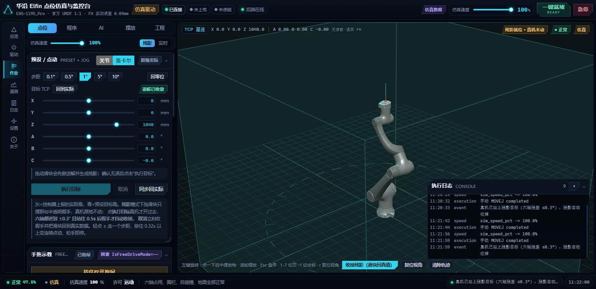

# NiHao Elfin Robot Studio

华沿 Elfin 机器人仿真与监控台是一套面向六轴机械臂的本地工业控制工作站。项目英文名称为 **NiHao Elfin Robot Studio**，中文名称为 **华沿 Elfin 机器人仿真与监控台**。



## 项目定位

NiHao 将仿真、点位示教、关节与笛卡尔运动、程序执行、AI 计划、摆放场景、摄像头和真机监控集中在一个本地界面中。仿真模式默认与真机隔离，适合在没有连接机器人时编写和验证程序；连接真机后，界面会显示控制器状态、关节角、TCP 位姿、IO、告警和执行日志。

## 主要能力

- 六轴关节运动与笛卡尔 TCP 运动仿真
- FK/IK、限位、围栏、自碰撞、地面和摆放物碰撞检测
- 点位保存、改名、残影预览和直接执行
- 中英文程序指令、Python 风格循环/判断/函数、代码补全和程序库
- 程序解析、启动、暂停、继续、停止与执行回执
- AI 自然语言计划生成与人工确认执行
- 多工具模板：无工具、两指夹爪、吸盘，并预留工具 IO 映射
- Intel RealSense / 普通 USB 摄像头枚举、选择、彩色流和深度流接口
- 本地事件日志、状态栏、回放和设备诊断

## 快速启动

Windows：

```bat
run_sim.bat
```

开发模式：

```bat
run_sim.bat dev
```

手工启动后端：

```powershell
.venv\Scripts\python.exe -m uvicorn sim.backend.main:app --host 127.0.0.1 --port 8710
```

前端构建：

```powershell
cd sim\web
npm install
npm run build
```

打开 <http://127.0.0.1:8710>。

## 安全边界

默认启动为仿真模式，真机连接必须由操作者在驱动页明确切换。真实控制器 IP、API 密钥和运行日志不应提交到公开仓库。请复制 `.env.example` 为 `.env`，再填入本机密钥；不要把 `.env` 上传到 GitHub。

真机运动前必须确认机械臂周围无人、急停可用、工具和负载已核对，并按现场安全规程进行低速单步验证。项目中的仿真结果不能替代现场风险评估。

## 硬件与数据来源

当前模型针对华沿 Elfin E05-1195_Pro，关节限位、URDF、正逆运动学和控制器协议资料保存在 `docs/`、`_pd/` 与 `huayan-ros2-docs/`。未经现场验证的控制器指令和末端工具 IO 映射会在界面中明确标记。

## 目录

```text
sim/backend/       FastAPI 后端、仿真驱动、运动学、安全层和程序运行器
sim/web/           Vue 3 + Three.js 前端
huayan_panel/      PyQt6 桌面面板
tools/             离线检查、运动学验证和 UI 验收脚本
docs/              工程方案、相机集成和验收资料
```

## 许可证

当前仓库尚未指定开源许可证。公开发布前请根据硬件协议、模型资源和第三方依赖的授权情况选择许可证。

