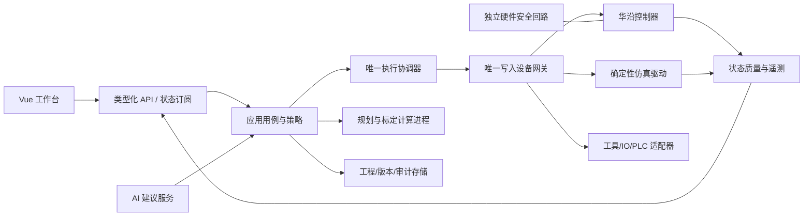

# 01 全系统总体方案

## 1. 产品目标与质量定义

产品名暂定 HuaYan 工业机器人工作站。核心价值是：操作者看得清、改得对、预演可信、执行有证据、失效可控、问题可追溯。面向示教员、工艺工程师、设备维护、集成工程师和软件开发者。

“高水平”必须落实为六项结果：

1. 同一机器人状态驱动显示、联锁、程序和停止判定，断线后不会假装在线。
2. 关节、TCP、坐标系、工具、负载和轨迹类型具有一致且可追溯的定义。
3. 每次动作都有请求、校验、预检、回执、实际运动、停稳和完成证据。
4. 输入、布局、异常反馈、键盘和窗口缩放形成统一组件规范。
5. 性能、恢复能力、安全边界和交付质量由自动化与现场证据共同确认。
6. 创新功能改善具体工艺指标：调试时间、错误定位时间、空跑发现率、任务复用率；不以增加按钮数量衡量。

## 2. 基线与证据口径

本轮静态核查：`sim/web/package.json`、`App.vue`、`store.js`、`vite.config.js`，后端入口、执行器、运动学、规划、标定、AI、协议，以及现有修复和测试记录。没有连接真机。

| 项目 | 已有基础 | 重构要求 |
|---|---|---|
| UI | 深色工作台、状态栏、导航、面板 | 页面结构、组件、响应式、编辑模型统一 |
| 连接 | 10003 命令串行、JSON Data Sheet、代次与新鲜度 | 能力版本、异构链路健康、重连协议、半断线分类 |
| 执行 | `MotionExecutor` 持有活动任务和 epoch | 完整动作账本、未知结果、停止优先、控制权管理 |
| 运动 | URDF FK、几何雅可比 IK、局部初值、预览退回 | 坐标/工具一致、MOVEJ/MOVEL 分开、速度/加速度/jerk |
| 仿真 | 六轴同步五次时间缩放、对象重力和碰撞近似 | 能力语义一致、时间确定、传感器/工具/故障仿真 |
| 工程 | 预检、标定、IO 映射、回放、黑匣子 | 版本化资产、验证等级、工具安装与识别闭环 |
| 程序 | 自定义 DSL、参数、异步步骤、断点基础 | AST/IR、类型、诊断、原生控制器作业适配 |
| AI | 白名单计划、人工确认、计划上下文校验 | 证据引用、工具/工艺约束、评测、模型隔离 |
| 数据 | JSON、原子写、JSONL | 事务、迁移、备份恢复、审计外部锚定 |
| 交付 | 两个启动脚本、自检工具 | 可复现依赖、统一启动器、安装包、FAT/SAT |

现有 `IMPLEMENTATION_STATUS.md` 所称“签名执行”实质包括上下文摘要和服务端一次性计划标识；普通 SHA-256 摘要不等于密码学签名。后续文档统一称“计划绑定与有效性校验”，只有使用明确密钥签名并验证时才使用“签名”。

现有修复不能因旧审查报告曾指出问题而被当作仍未修复。每项缺陷必须重新复现或标注“历史已修复、需回归”。

## 3. 全生命周期范围

| 域 | 核心范围 | 关键产出 |
|---|---|---|
| 产品与工艺 | 人群、作业场景、工艺约束、离线/现场流程 | 用户旅程、工艺验收用例 |
| 设备档案 | 型号、固件、序列号、URDF、参数、证据 | RobotProfile 与兼容矩阵 |
| 控制协议 | 字段、命令、版本、回执、错误、能力 | CapabilityRegistry、协议契约测试 |
| 示教 | 关节、笛卡尔、增量、速度、工具坐标 | 统一示教工作台 |
| 运动规划 | FK/IK、关节路径、直线/圆弧、轨迹预检 | 可执行且可解释的 MotionPlan |
| 工具与负载 | 夹爪、吸盘、多工具、识别、手动确认 | ToolProfile、安装状态与动作契约 |
| 工位与标定 | 基座、工具、工件、障碍物、标定 | 版本化坐标树与工程包 |
| 数字孪生 | 几何/运动/状态/工具/IO、故障注入 | 仿真等级与对账报告 |
| 工艺编程 | DSL、图形编排、调试、原生程序管理 | 统一 IR 和程序版本 |
| IO 与外设 | 命名、极性、去抖、握手、恢复 | 接线档案、设备适配器 |
| AI | 解释、计划草案、检索、风险与成本评测 | 有出处的建议与受约束计划 |
| 遥测与诊断 | 温度、电流、力、通信、动作、异常 | 实时看板、诊断包、时间轴 |
| 数据治理 | 工程、配方、程序、工具、审计、备份 | 版本、事务、迁移和恢复证据 |
| 安全 | 机械应用安全、网络、数据、AI、供应链 | 威胁模型、门禁、风险档案 |
| 性能与稳定 | 渲染、状态流、求解、存储、长稳 | 可重复性能报告 |
| 工程质量 | 类型、契约、测试、CI、代码规范 | 可复现构建、回归与追踪 |
| 部署运维 | 安装、启动、升级、降级、支持 | 发布包、运行手册与健康诊断 |
| 集成扩展 | PLC、视觉、MES、多机器人、远程观察 | 接口规范和扩展资格门禁 |
| 法规与交付 | 适用标准、FAT/SAT、培训、维护 | 合同验收与交付证据包 |

## 4. 用户流程

首次使用：检查运行环境 → 选择仿真/连接机器人 → 获取设备身份 → 匹配设备档案 → 确认安装工具 → 核对 TCP/负载/IO → 建立工位 → 导入或示教点位 → 预演程序 → 输出检查报告。

日常作业：加载工程与配方 → 核对机器人/工具/工件版本 → 就绪检查 → 选择作业 → 预检 → 受控执行 → 监视到位与 IO → 保存结果。

故障恢复：停止或失效锁定 → 保存上下文 → 定位通信/运动/IO/工艺原因 → 现场处理 → 重新读取实际状态 → 核对工具及工件 → 明确选择恢复点 → 重新预检 → 继续。禁止重连后自动补发旧运动。

工具切换：停止活动执行 → 确认停稳/允许换装 → 读取可用身份 → 无可靠身份时手动选择 → 确认实际安装 → 核对 TCP/负载/电气映射 → 更新模型 → 作废旧计划 → 重新预检。

## 5. 目标架构

采用模块化单体业务服务加独立设备网关、可终止计算进程。前期不引入微服务集群。普通 Web 服务不是实时伺服控制器；插补和安全控制由支持的机器人控制器或经过验证的运动网关承担。



依赖方向：界面/API → 应用用例 → 领域与端口；适配器实现端口。领域不能依赖 FastAPI、Vue、数据库模型或厂家报文。AI 只能调用受约束应用用例，不持有设备写入句柄。

单写入原则：一个机器人只允许一个受仲裁的写入网关。Web API 可按需求扩展，但不能启动多个携带 `World()` 的进程直接连接同一控制器。厂家的示教器和外部控制权也必须按实际协议读取或现场确认。

## 6. 目标目录

```text
apps/
  workstation/             Vue + TypeScript 工作台
    src/app/               启动、路由、布局、错误边界
    src/features/          teach/program/tools/workcell/ai/diagnostics
    src/components/        通用控件与工业状态组件
    src/design-system/     tokens、主题、组件规范
    src/scene/             场景、资源、渲染、拾取、坐标转换
    src/transport/         生成 API、订阅、快照恢复
services/
  api/                     FastAPI 入口、会话、路由、依赖
  robot_gateway/           驱动、命令队列、设备锁、通信
  compute/                 求解、轨迹、碰撞、标定工作进程
packages/
  domain/                  单位、坐标、工具、状态、执行、程序 IR
  application/             用例、预检、编译、切换与恢复
  adapters/                huayan/sim/tool_io/plc/vision/storage/ai
  contracts/               JSON Schema / OpenAPI / 错误码
profiles/                  机器人、固件、工具、设备与工艺模板
assets/                    模型源文件、生成参数、许可、校验摘要
tests/                     domain/contract/integration/e2e/hil/perf/security
scripts/                   setup/start/stop/doctor/build/migrate/backup
docs/                      规格、架构决策、操作、现场与发布记录
```

这是目标组织方式，不要求第一步移动所有文件。迁移适配层先保留现有 URL 和导入入口，避免一次重命名导致大量回归。

## 7. 技术决策与取舍

| 决策 | 默认方案 | 理由与边界 |
|---|---|---|
| 前端框架 | 保留 Vue 3 / Pinia / Three.js，渐进 TypeScript | 重用资产与行为；不因重构改成另一套框架 |
| 前端路由 | 类型化路由，旧 hash 兼容重定向 | 可测试导航、工程链接和状态恢复 |
| 设计系统 | 自有语义 tokens + 可访问性基础控件 | 工业布局需要精确读数和动作状态 |
| 表单 | 草稿模型 + 统一校验；复杂表单再选验证库 | 避免每帧重写输入；不盲目全局 `.number` |
| 后端 | Python / FastAPI + 明确应用生命周期 | 当前技术可继续，阻塞计算移出控制循环 |
| 计算 | 有界进程工作池，纯输入/纯输出 | Python CPU 求解不应挤占事件循环或无法终止线程 |
| 设备 | 网关单实例 + CapabilityRegistry | 版本差异和安全条件集中管理 |
| 数据库 | 本地 SQLite 事务库 + 独立遥测分段文件 | 工程配置事务一致，避免无需求引入 Redis/PostgreSQL |
| 部署 | 本地生产构建、默认回环、离线安装包 | Windows 当前环境优先；网络部署是独立配置 |
| ROS/MoveIt | 按确切硬件资格接入 Linux 网关 | 官方 ROS2 仓库标为 beta，不直接许诺当前型号可用 |
| 原生程序 | 先管理控制器已有程序，再验证上传接口 | 协议有程序生命周期；文件上传另需厂家证据 |
| 动力学 | 分等级构建，实验辨识后启用 | 不凭 URDF 质量参数声称与真机一致 |
| 高级集成 | 适配器、隔离和契约；逐项验收 | OPC UA/Modbus/视觉/MES 能力不一次硬编码 |

官网产品参数、通信刷新宣传值不是 Python 接口实际控制频率。现有约 20 Hz 状态流、50 Hz 仿真循环、浏览器渲染和控制器内部刷新率分别测量。不得从宣传 1,000/2,000 Hz 推断本软件具备同级实时性。[华沿产品页](https://www.huayan-robotics.com/elfin-pro)

## 8. 领域模型

| 实体 | 必需字段/版本 | 设计约束 |
|---|---|---|
| RobotProfile | 型号、固件区间、URDF hash、限制、来源、验证等级 | 未匹配禁止静默套用官网其他型号参数 |
| StateSample | epoch、seq、采样/接收时间、质量、字段存在性 | missing/stale 不转换为 0 |
| FrameDefinition | parent、SE(3)、校准 revision、误差与来源 | 单一坐标树，不混法兰与 TCP |
| ToolProfile | 几何、TCP、质量/重心、IO、识别、动作 | TCP 选择不等于实际工具存在 |
| MountedTool | tool revision、identity evidence、确认时间、状态 | 实物更换与数字选择分开 |
| Workcell | 障碍物、工具、工件、基座、配方、revision | 每次变化作废相关计划 |
| Point | q、pose、frame、robot/tool revision、来源 | 示教采样记录质量；只读展示与编辑流程分开 |
| ProgramRevision | 源码、AST/IR、依赖、编译结果、hash | 执行的是冻结版本，编辑不改变运行程序 |
| MotionPlan | 起点、路径、工具/场景/参数、有效期、能力 | 预览、预检、执行消费同一计划 |
| ExecutionRecord | 动作、步骤、回执、观测、结果、恢复证据 | accepted 与 reached 严格分开 |
| Calibration | 样本、拟合、独立验证、条件数、有效期 | 训练残差不作为定位精度 |
| AuditEvent | request/exec IDs、来源、结果、摘要/锚定 | 不记录密钥；可验证但不虚称绝对防篡改 |

版本不使用每帧状态 seq 作为工程变更版本。姿态起点有效性用测量误差/允许漂移校验；工程对象和工具变化用 revision 精确失效。

## 9. AI 与创新产品线

| 功能 | 已有基础与增量 | 可量化验证 |
|---|---|---|
| 有执行证据的任务助手 | 白名单草案升级为工具/IO/坐标依赖 + 逐步预检 | 非法/幻觉任务拒绝率、有效计划率、误操作用例零越权 |
| 轨迹健康报告 | 现有预检加入速度/加速度/jerk、工具扫掠体与版本 | 在标注测试集上报告覆盖与误报率 |
| 工具感知工作台 | 新增识别置信、手动确认、TCP/负载联动 | 未确认工具不执行工具依赖任务、切换后无旧计划通过 |
| 黑匣子与复现包 | 现有快照升级为前后窗口、时间对齐、离线复现 | 指定故障重放复现；包中无密钥 |
| 自动标定向导 | 已有 TCP/三点拟合加入姿态设计、质量解释、独立验证 | 对比外部测量，记录实际误差而非保证值 |
| 故障实验室 | 注入断线/半断线/延迟/IO 卡死/传感器缺失 | 每次出现预定失效状态且不越过写入门禁 |
| 工艺模板库 | 抓取、吸附、搬运、上下料、码垛参数化 | 换工件后依赖与轨迹正确重检 |
| 节拍解释与方案对比 | WAIT、运动、IO 等待分解；虚拟比较不同布局 | 仿真估计与实测节拍差异可解释 |
| 工程包可复现 | 模型、工具、坐标、程序、配方和证据导出 | 干净环境恢复后相同版本生成一致计划 |
| 影子偏差监测 | 现有遥测偏差升级为时钟对齐和负载分组 | 与独立样本对账；缺少传感器时显示不可评估 |

预测性维护和自动力控优化列为研究功能：必须先获取长期标签、真实力传感器、工具/负载条件与厂家接口。只凭温度电流曲线不输出“剩余寿命”承诺。

## 10. 外设与生产集成

- PLC：握手信号表、心跳、序号、互锁、超时、异常恢复；映射与设备地址版本化。
- Modbus TCP：功能码/寄存器白名单、端序、缩放、超时和轮询预算；不假定支持的安全功能。
- OPC UA：按现场需要引入只读状态与作业接口；证书、命名空间和订阅限额。
- 相机：设备健康、采集、内外参、手眼标定、检测结果置信和过期判定；结果经几何与工艺验证进入程序。
- MES：工单、配方、结果、质量状态和追踪码；业务断网不自动改变机器人运动。
- 多机器人：从单机网关复制可独立控制的域，增加资源锁和共享区域协调；共享区域安全仍需专门现场设计。
- 远程：优先只读诊断；远程控制需明确部署模式、设备控制权和现场支持，不作为默认打开能力。

## 11. 工程制度

每个变更绑定需求 ID、设计决策、回归、风险和证据。代码使用前端 strict TypeScript、后端类型注解，统一命名与格式；单位在接口字段名和类型中显式表达。

示例（目标代码风格，不是当前实现）：

```typescript
type PoseTarget = Readonly<{
  frameId: string;
  positionMm: readonly [number, number, number];
  orientationXyzw: readonly [number, number, number, number];
  toolRevision: string;
}>;
type PlanResult =
  | { kind: 'ready'; planId: string; achieved: PoseTarget }
  | { kind: 'partial'; fraction: number; achieved: PoseTarget; reason: string }
  | { kind: 'rejected'; code: string; reason: string };
```

始终执行：隔离测试、校验有限数、清晰状态、错误可追踪、迁移可恢复。需要具体现场条件：实体动作、IO 极性、硬件保护、安全参数及控制器原生能力。禁止：测试触碰原始审计/真机、自动绕过联锁、把未知当已知、静默降低安全质量、删掉失败测试掩盖问题。

## 12. 范围完成定义

UI 完成：设计规范逐页落实并通过多分辨率/缩放/键盘/错误状态验收。

软件完成：所有必选需求有代码与可复現证据；单写入、未知结果、停止、数据迁移、工具切换、程序和仿真闭环全部通过。

真机完成：实际型号/固件/工具/负载下，控制协议、路径类型、停止行为、IO、精度和长期运行逐项验证。

工业交付完成：FAT、SAT、适用安全评审、安装升级回退、备份恢复、培训、维护与证据归档完成。任何“仿真通过”都不能自动晋级为“现场通过”。
